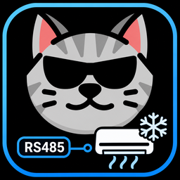

# Hitachi RS485 HVAC



獨立的 Home Assistant HACS 整合，透過透明 TCP ↔ RS485 閘道器控制日立 **RC-R02XT 空調**。目前測試版本 **0.1.3rc1**；正式部署前請完成 [硬體驗收](docs/v0.1.0-acceptance.md)。本專案非日立官方產品。

## 架構與系統需求

```text
Home Assistant → Hitachi RS485 HVAC → TCP ↔ RS485 Gateway → RC-R02XT × 多台空調
```

- Home Assistant **2026.10.0+**；開發環境 Python **3.14.2+**。
- 透明 TCP serial gateway；預設 TCP port 502，可自訂。
- RS485：9600 bps、8 data bits、1 stop bit；同位檢查配合轉換器 DIP 設定（出廠 none）。
- Slave 1–247 可搜尋；官方文件的實體匯流排上限為 32 台轉換器，請依現場配線與閘道器負載規劃。
- 設定轉換器允許快取狀態 `0x40–0x44` 多筆讀取（依官方說明設定 DIPSW1 PIN5）。配線與 DIP 調整應在斷電下由合格人員操作。

**Modbus RTU frame over TCP ≠ Modbus TCP / MBAP。** 只有 Modbus TCP / MBAP 模式的閘道器無法使用，請改為透明傳輸模式。

成熟的單一 Transport、Scanner 獨占、latest-wins queue、target-period scheduler 與 Monitor 設計改編自 [Coselig v1.6.3](https://github.com/JK0526/coselig-modbus-hub/tree/v1.6.3)，保留 MIT 授權。本整合不依賴 Coselig，也不會修改其儲存庫。不需要 MQTT、Node-RED、ESPHome 或 pymodbus。

## 支援硬體與範圍

RC-R02XT 搭配官方型式碼 1–6 的空調（RAD、RAS、RA、CRD、CRS、RPI）。每個 Slave 建立一個 HA Device，下面包含 Climate、故障與已探測支援的感測器；不捏造實際空調型號。

不支援 RC-R01XT legacy、除濕機、全熱交換器、8 房集中控制器、Swing UI、任意 Modbus 寫入、計數器歸零或推估功率。Scanner 仍顯示讀得到但不支援的裝置，不會建立其 Climate。身份資料不足時保守列為 unknown/legacy。

## HACS 安裝

1. HACS → **Custom repositories**。
2. Repository URL 填入 `https://github.com/JK0526/hitachi-rs485-hvac`。
3. 類型選 **Integration**，新增並下載 **Hitachi RS485 HVAC**。
4. 重新啟動 Home Assistant。
5. 設定 → 裝置與服務 → 新增整合 → **Hitachi RS485 HVAC**。

測試版本與正式版本均透過 HACS 版本選單安裝；測試版本標記為 Pre-release，現場驗收通過後才發布正式版。

手動安裝亦可：將 `custom_components/hitachi_rs485` 複製到 HA 的 `config/custom_components/` 後重新啟動。不需 YAML。

## 初次設定與搜尋設備

1. 輸入 Gateway Host / Port；程式只先測試 TCP 連線。
2. 進入搜尋範圍頁面，預設 1–247；**不會自動開始搜尋**。
3. 按「開始搜尋」，查看 HA 進度畫面。縮小至現場實際使用的範圍可縮短時間。每個無回應位址約需等待 1 秒，預設全範圍可能需數分鐘。
4. 搜尋結果列出找到的設備、既有設備與本次未找到的設備；只可選擇支援的新裝置。
5. 檢查摘要，按「確認並儲存」。

搜尋只用 FC03，會暫停背景輪詢並取得匯流排獨占權。執行期間 Climate 控制會拒絕；搜尋結束恢復。CRC 錯誤與無回應保留紀錄，單台設備錯誤不會中斷整個範圍。重搜不會自動刪除失聯裝置。

## Climate

- 開關、COOL、DRY、FAN、AUTO，以及確認支援的 HEAT。
- RPI 依官方文件不提供 AUTO。
- 目標溫度 16–32 °C，步進 1 °C。
- 風速：Auto / High / Medium / Low / Quiet；RPI 不開放 Quiet。
- 不同運轉模式可用風速依官方設備限制；不適用的組合可能回傳 Modbus exception，整合不會猜替代值。
- 暖氣預設 Auto：官方 `0x0004=1` 或曾讀到 mode 4 才啟用；可在單台裝置設定覆寫。
- 未知 mode/fan 值保留 raw 資料，顯示 unknown，不會因未知值使整台不可用。
- 禁止 optimistic state。FC06 成功後讀回 `0x40–0x44`，並另外讀取 `0x23` 確認目標溫度。讀回失敗保留最後確認狀態。

官方快取狀態每秒更新一次，因此命令剛送達時的讀回仍可能是前一次快取；後續輪詢會校正。Poll=0 時若需再次確認，請使用 HA 的 `homeassistant.update_entity` 明確刷新 Climate。設備初始未讀狀態為 unknown，可明確下達控制；曾發生 Gateway 中斷後，須先由明確刷新或恢復輪詢重新確認狀態。

## 感測器與 Energy Dashboard

| Entity | 預設 | 說明 |
|---|---|---|
| Climate | 啟用 | 每個支援的 Slave 一個 |
| 室內溫度 | 啟用 | 與 Climate 共用 `0x43` confirmed state，不增加輪詢 |
| 累積用電量 | 能力探測成功才建立 | `0x38 / 10` kWh |
| 室外溫度 | 能力探測成功才建立 | `0x0A` °C，官方 unsigned 編碼 |
| 運轉電流 | 診斷、預設停用 | `0x0F / 10` A |
| 故障 | 啟用 | `0x44 != 0` |
| 故障碼 | 診斷 | 原始代碼，不猜錯誤文字 |
| 保養／濾網清洗累積運轉時間 | 診斷、預設停用 | 探測 `0x39/0x3A` 成功才建立，單位小時 |

Energy 使用 `ENERGY` / `TOTAL_INCREASING` / `kWh`，可在 HA **設定 → 儀表板 → 能源 → 個別裝置** 加入。從 raw 137 得到 13.7 kWh；官方最大 raw 40000，超過後歸零。直接發布設備計數器，依 [HA sensor semantics](https://contributors.home-assistant.io/core/entities/sensor/) 由長期統計處理歸零，不建立人工累加器。重啟後等待真實讀取，避免用虛構的 0 造成統計重置。

不提供 Energy Reset、維護計時歸零或濾網計時歸零介面。沒有 Power sensor，也不以電流乘 220 V 推估功率。若同一室外機連接多台室內機，官方資料未明確保證每個 Slave 的用電數字可相加，請現場核對，避免 Energy Dashboard 重複計算。

## Polling 與通訊設定

| 設定 | 預設 | 限制 |
|---|---|---|
| 快速輪詢週期 | 2 秒 | 0 停用所有背景讀取；非零至少 0.5 秒 |
| 慢速輪詢週期 | 30 秒 | 0 停用慢速讀取；非零至少 10 秒 |
| 搜尋範圍 | 1–247 | 起點不得大於終點 |

Fast 每台依序送兩筆 FC03：`0x0040` count 5（狀態）、`0x0023` count 1（設定溫度），完成後才讀下一台。Slow 僅讀已支援的 optional registers，不重複讀設定溫度。兩者共用同一排程與 socket；非零週期是「目標週期」，當整輪耗時超過設定，不會積壓新工作。大量 Slave 應提高輪詢週期。

Fast=0 不會偷偷背景讀取，明確控制／讀回、明確刷新、搜尋、Monitor 與 TCP reconnect 仍能使用。單一 timeout 不立刻判離線；連續 3 次 fast read 失敗才標記 Slave 不可用。Gateway TCP loss 與 Slave timeout 分開處理。

## Options 與 Reconfigure

整合選項 → 設備管理：

- 新增裝置：搜尋 RS485 裝置，選擇新裝置，確認摘要。
- 管理已安裝裝置：選 Slave，設定暖氣 Auto / Supported / Unsupported，或明確勾選移除，再確認摘要。
- 通訊設定：快／慢週期及搜尋範圍，確認摘要才儲存。
- Cancel 不儲存任何暫存變更；流程未確認前關閉也不會更動 entry。

Host / Port 使用整合選單的 **Reconfigure／重新設定**，不放在 Options；驗證新端點成功後 reload，保留 Device／Entity IDs。Options 儲存後亦 reload。依 [HA Config Flow](https://github.com/home-assistant/developers.home-assistant/blob/master/docs/core/integration/config_flow.md) 使用原生流程。

## Monitor

側邊欄 **Hitachi RS485 Monitor** 所有已登入使用者可見。可選 Gateway、Slave、封包類型；顯示 raw TX/RX HEX、timeout、CRC error、Modbus exception、延遲、Device Health、通訊統計及佇列深度。

- **暫停畫面**：停止 UI 更新，仍收集有界歷史；不停止通訊。
- **暫停輪詢**：只暫停該 Gateway 背景輪詢，允許正在處理的 request 結束；明確控制／搜尋／重連不受影響。
- **清除封包**：只清除歷史，不修改設備。
- **自動捲動**：可關閉以查看舊資料。
- 點封包：解析 FC03、FC06、FC10，對應 climate state、energy 等 register；未知資料顯示 Raw Modbus。

後端保留 200 筆 Trace；前端本機最多 1000 筆。手動指令可讀取合法範圍；寫入僅開放已配置設備的原廠控制暫存器，不提供 Energy reset。

## 多 Gateway

每個 TCP Gateway／RS485 bus 建立一個 Config Entry。Transport、狀態、佇列、統計、選項均獨立；同一端點避免重複建立。Monitor 可切換 Gateway。變更 Host / Port 不會改 Slave identifiers。

## 疑難排解

1. TCP 連線失敗：檢查主機、連接埠、防火牆與閘道器供電。TCP 通過不代表 RS485 通訊一定正確。
2. 搜不到：確認透明 RTU 模式、9600 bps、同位檢查、A/B 接線、終端電阻、Slave ID，以及該 bus 沒有另一個 master 同時存取。
3. CRC error：檢查配線、接地、鮑率與 gateway serial buffering；不要只加快重試。
4. exception 02：該 register 可能不支援；optional capability 會略過，不影響 Climate。
5. Climate state unknown：先明確刷新或啟用輪詢；未知 raw enum 可在 Diagnostics 與 Monitor 查看。
6. Energy 不顯示：確認能力探測成功、慢速輪詢已啟用，等待實際數值；在整合選項重新搜尋並確認變更後，即可更新既有裝置的能力。暫時逾時或 CRC 錯誤不會移除既有能力；明確的 exception 02 才會移除該能力。
7. Gateway 中斷：佇列內未送出的控制會丟棄，不會重連後重播。重連使用 1/2/4/8/15/30 秒有界退避。
8. 詳細資料：HA 裝置與服務 → 整合 → 下載診斷；Host 會遮罩，包含身份、能力、raw、健康度與統計。請仍自行檢查再對外分享。

## 已知限制與安全

尚未實機驗收；請依 [驗收清單](docs/v0.1.0-acceptance.md) 驗證。官方文件將溫度標為 unsigned，零下溫度未猜編碼。風速特殊碼保留 unknown。非支援設備不會被當成空調控制。軟體測試不能證明 Gateway 的實際 serial buffering、電氣負載或快取更新延遲。

TCP 透明傳輸通常無驗證與加密，只在可信任內網使用；勿直接暴露到網際網路。電氣接線、DIP 與終端電阻請按原廠文件處理。使用者可移除 HA 裝置，但本整合不會自動刪除搜尋未出現的裝置，也不提供危險的任意寫入工具。

## 開發／測試

```bash
python3.14 -m venv .venv
.venv/bin/python -m pip install --group dev
.venv/bin/ruff check .
.venv/bin/ruff format --check .
.venv/bin/pytest
node --test tests/frontend/monitor.test.cjs
```

測試使用 Python 3.14、真實 HA 2026.10.1 test fixtures 與 loopback 模擬 Gateway，不連接現場設備。Coverage 包含全部整合 Python 檔案與 branches，CI 門檻 95%；沒有排除 core 模組。Node 原生 test runner 驗證 Monitor 操作與 decoder。CI 同時執行 lint、format、pytest、coverage 與前端測試。

文件：[協定與能力矩陣](docs/protocol.md) · [架構](docs/architecture.md) · [驗收報告](docs/v0.1.0-acceptance.md)。完整規格與交付對照見驗收報告。MIT License。

### Fast Poll 負載監測（0.1.3rc1 測試版）

Monitor 顯示設定 Fast 週期、最近一輪耗時與最近 20 輪完整 Fast Poll 平均耗時（包含所有 Slave 的狀態與設定溫度讀取）。負載 = 平均耗時 ÷ 設定週期 × 100%。

- 未滿 20 輪：顯示樣本不足與目前平均負載，暫不判定警告。
- < 80%：正常；80%～< 100%：注意；>= 100%：超過目標週期。
- Fast=0 顯示停用，無設備或無完整樣本顯示無資料；執行時暫停顯示已暫停，不計算負載。
- 警告僅顯示於 Monitor，不寫入持續性 HA Log／Notification，不自動變更週期。
- 單獨 Target 讀取錯誤保留已確認的狀態及設定溫度，以既有 optional unavailable 與通訊統計呈現；GatewayError 仍沿用既有斷線恢復機制。
- 保留單一 worker、1 秒 timeout、75 ms 最小 transaction turnaround、控制優先及 Scanner 獨占。
- 超過目標週期仍完成目前輪詢，不並行、不累積工作；下一輪依原有「起始時間 + 週期」排程，不額外固定等待一個週期。

本整合隱藏預設分支版本，HACS 版本選單提供已發布的 Tag／Release。測試版本需啟用 Beta 版本顯示，選擇 `v0.1.3rc1`；現場驗收通過後再選擇正式版。安裝後重新啟動 Home Assistant。Monitor 前端靜態資源網址會隨整合版本更新。

## 0.1.3rc1 手動指令與送風模式

Monitor 的「手動指令」可輸入原始 HEX，預設自動附加 CRC16 並預覽完整 TX。取消自動 CRC 時必須提供正確 CRC。支援 FC03、FC06、FC10；寫入需要確認，後端再次依既有 Hitachi 控制暫存器、值域與設備能力驗證。禁止 Broadcast、未知／保留暫存器及重置寫入。交易使用原有 Socket／Worker，Trace 標示 MANUAL；不重試寫入、不直接改 Climate confirmed state。

已登入的一般使用者可進入 Monitor 並送出手動指令；未登入請求由 Home Assistant 拒絕。清除紀錄與暫停輪詢仍需要管理員。手動交易會等待先前工作完成並獨占交易；發送中拒絕重複手動命令，取消等待也會先完成在途交易的清理。

Fast 讀取成功確認 FAN_ONLY（MODE_STATE=2）時略過 Target，Climate 設定溫度顯示無資料，保留最後確認快取。其他模式或 Fast 讀取失敗時仍嘗試 Target；真正的 Exception 仍會記錄。控制後讀回採相同規則。

搜尋沿用原生 HA Progress Flow；先刷新目前 Slave、掃描數與找到設備的原生描述，再更新百分比，避免 refresh 清空已顯示的進度。
