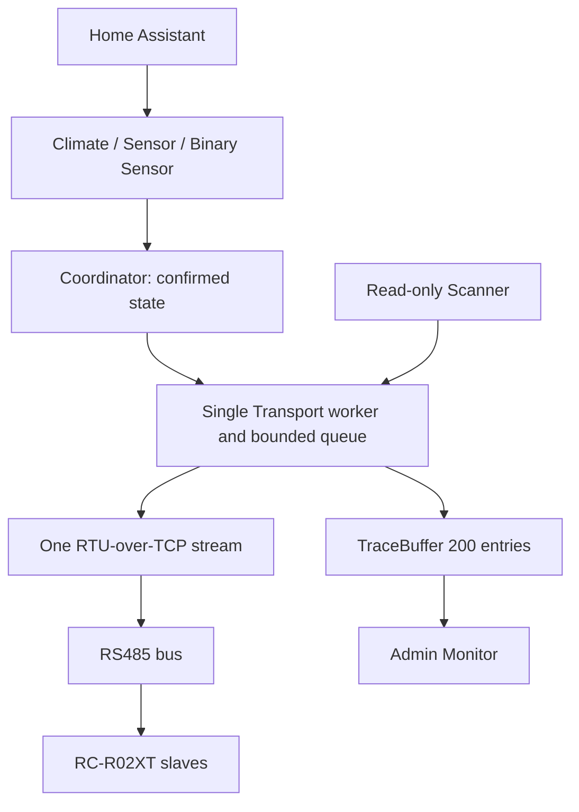

# Architecture

The independent source distribution adapts the MIT-licensed Coselig v1.6.3 transport, target-period scheduler, scan lease, TraceBuffer and Monitor patterns. It imports no Coselig module and has no Coselig runtime dependency. Product-specific relay/light/event/cover code is excluded.

## Ownership

One ConfigEntry owns a Hub, Transport, Coordinator, device states, counters and trace buffer. Each slave's stable device identifier is `(hitachi_rs485, entry_id + '_slave_' + slave)`; entity suffixes are stable across endpoint changes and reloads. All entities for a slave use that same identifier. Host/port are entry data; device and communication preferences are entry options. Mutable state is never shared across gateways.

Only the Transport worker writes the socket. One dedicated receive task reads it and delivers complete fragmented frames to one in-flight transaction future. The scheduler never creates overlapping poll rounds. Controls and scanner requests pass through the same transport, never through a second sensor/scanner connection. A timed-out/malformed exchange closes the ambiguous stream before another transaction; this is stream recovery, not a claim that the gateway is offline. Modbus exceptions retain the TCP connection. No command is automatically retried.

## Scheduling and controls

A stateful OrderedDict bounds unsent controls to 256 distinct keys `(slave, 'climate', field)`. Replacing a queued command resolves the old future as superseded and moves the newest submission to the end, preserving order among surviving different fields. The in-flight write cannot be undone. Queued work is discarded after a bus failure, preventing stale replay after reconnect. Polling is sequential and does not generate a backlog.

A single monotonic due-time loop schedules fast rounds (default 2 seconds) and slow rounds (30 seconds). Each next deadline is the round start plus its configured period; an overrun yields to the event loop then starts the due work. Slow reads share the same loop and worker, and must be at least 10 seconds when enabled. Fast non-zero minimum is 0.5 seconds. Fast=0 disables **all background reads**, including slow reads and initial setup reads; slow=0 only disables slow rounds. One initial TCP connection and reconnect remain possible without background register reads.

Runtime Pause Poll gates only background work, allowing an in-flight transaction to finish. Explicit controls/readback, refresh and discovery remain usable. Pause Display freezes rendering while the frontend continues collecting bounded trace history. It never changes the scheduler.

## Scanner

Hub scanning takes the coordinator round lock to pause round submission, then the transport gate to drain prior work and hold exclusive bus ownership. During scanning new controls are rejected rather than replayed later; background polls wait. Progress is delivered through HA's native progress flow. All scan transactions are FC03 and per-slave exceptions/timeouts do not stop the range. Options scanning requires the running Hub; it never opens a separate transport when the entry is unloaded.

## State, health and reconnect

The five cached climate state registers are authoritative. Acknowledging a write does not optimistically update state: targeted readback does. Optional target/sensor reads are tracked separately, so an illegal energy address cannot make climate unavailable. Unknown enum readings are retained in raw diagnostics. Three consecutive failed fast reads mark a slave unavailable; a successful fast read restores it. Gateway TCP loss marks all slaves unavailable immediately and discards unsent controls. A round with no successful fast reads can disconnect the stream without declaring all slaves failed at once.

The gateway reconnect scheduler uses bounded 1/2/4/8/15/30-second backoff, independent of Poll=0 and runtime pause. Reconnecting does not restore availability until an actual state read succeeds. On initial setup before any read, Climate is callable with unknown state (no fabricated power/mode), so explicit controls work even at Poll=0. A gateway loss latches communication trouble and requires a real refresh before availability returns. Sensors remain unknown/unavailable until their values are read. Last confirmed values remain in memory during communication trouble but are not loaded from storage at startup. Devices that disappear during discovery remain configured until explicit removal confirmation.

## Lifecycle and security

Unload cancels the poll loop and worker, cancels pending futures, cancels the sole reader and closes the stream. Options changes reload the entry. Reconfigure validates the new TCP endpoint before changing entry data and retains entry/device/entity IDs. Device removal prunes registry entries belonging to that slave only. Options use a private deep-copied draft and save only on final confirmation; cancellation never commits.

Monitor list/subscribe/clear/poll commands all require admin privileges. Static frontend registration is once per integration domain, with versioned module URL. WebSocket subscription timers belong to the client subscription and survive entry reload by resolving the current runtime on each tick. The Monitor exposes no register write/energy reset. Diagnostics redact host addresses and include only protocol state/configuration needed for troubleshooting. Local network transport has no encryption or authentication; deploy on a trusted network.
